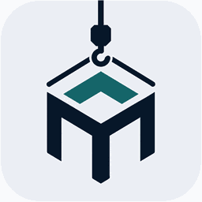

<h1 class="mdx-hero__title">Run Magento in your own cloud account.</h1>

Configure your Magento shop in PHP. Start it locally with Docker and deploy it to your AWS, Google Cloud or Azure account.

[Install the CLI](install.md){ .md-button .md-button--primary }
[Get started](getting-started.md){ .md-button }

Your cloud provider bills the resources to your account. [MageLift pricing](https://magelift.dev/pricing.md)

## Pick a path

-   **Start a shop locally**

    ---

    Install the CLI and start your existing Magento checkout.

    [Install](install.md) · [Getting started](getting-started.md)

-   **Move an existing store**

    ---

    Import settings from Adobe Commerce Cloud or Upsun and rehearse the cutover.

    [Cutover checklist](weekend-migrate.md) · [Full migration](migrating-from-paas.md)

-   **Operate a store**

    ---

    Inspect logs, manage secrets and check costs.

    [Operations](operations.md) · [CLI reference](cli-reference.md)

-   **Check what is supported**

    ---

    Find test results for your provider, runtime and operation.

    [Capability matrix](capability-matrix.md) · [Compare PaaS](compare-paas.md)

-   **Compare local and cloud**

    ---

    See which services run locally and which need a cloud account.

    [Local vs cloud](local-vs-cloud.md)

-   **Extend MageLift**

    ---

    Add a cloud target through the provider boundary.

    [Adding a provider](adding-a-provider.md)

## Cloud targets

Start a PHP project for AWS ECS Fargate, GCP GKE Autopilot, or Azure AKS.
AWS and GCP have historical live Magento runs. Azure has Pulumi graph and
Floci coverage. Use the evidence for the individual operation when choosing
a deployment target. AWS EKS, GCP GKE Standard, OVH MKS and Scaleway Kapsule
have experimental adapters. [Recorded capabilities](capability-matrix.md)

## Contribute

[CONTRIBUTING](https://github.com/magelift/magelift/blob/main/CONTRIBUTING.md) ·
[SUPPORT](https://github.com/magelift/magelift/blob/main/SUPPORT.md) ·
[Code of Conduct](https://github.com/magelift/magelift/blob/main/CODE_OF_CONDUCT.md) ·
[SECURITY](https://github.com/magelift/magelift/blob/main/SECURITY.md)

Agent skills for contributors:
[`agents/`](https://github.com/magelift/magelift/tree/main/agents) in the repo.

Plain-text site index: [llms.txt](https://magelift.dev/llms.txt),
[llms-full.txt](https://magelift.dev/llms-full.txt).

MageLift is independent of Adobe Inc. Magento and Adobe Commerce are Adobe
trademarks, used only to describe compatibility.
